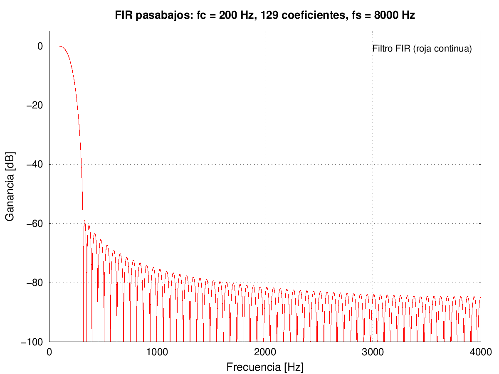
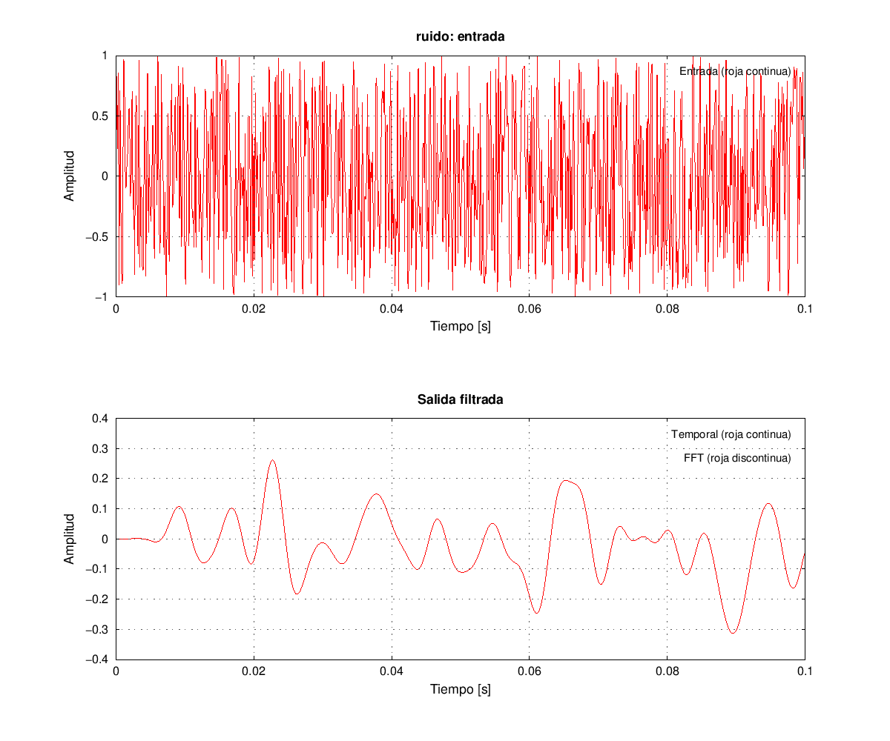
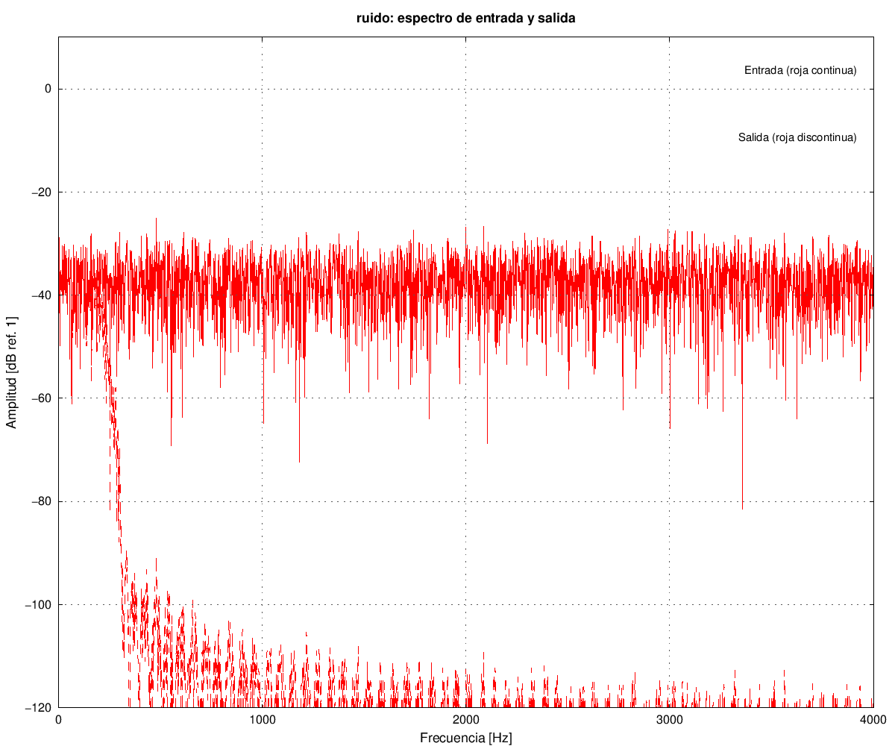
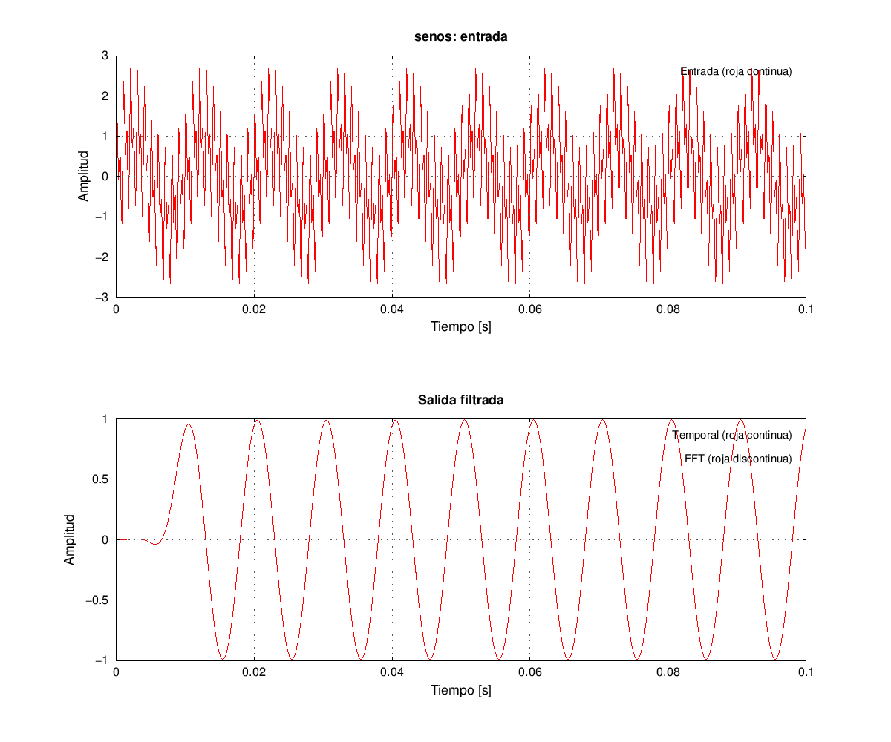
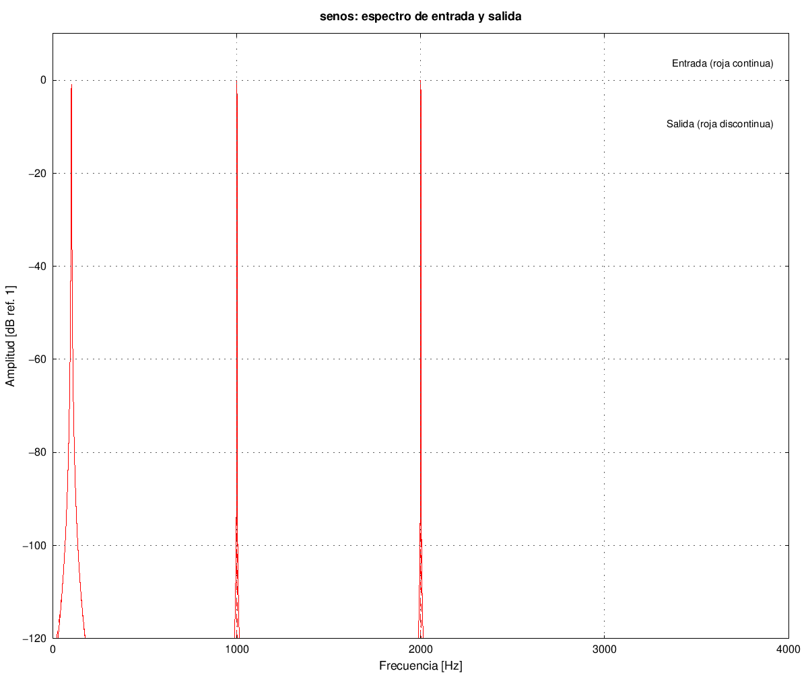

# Trabajo practico 7: procesamiento digital basado en bloques

## Alcance y especificaciones

Se resuelve el diseno y la simulacion en PC de un FIR pasabajos mediante convolucion temporal y convolucion rapida por FFT. Por indicacion del alumno se excluyen la implementacion en placa, el generador de funciones, el osciloscopio y las mediciones de hardware. Del ejercicio 2 se desarrolla la comparacion del algoritmo FFT en PC.

La consigna establece fs = 8000 Hz, paso de 0 a 200 Hz y rechazo de al menos 40 dB. Por indicacion posterior del alumno, se configura 200 Hz como frecuencia de corte nominal (aproximadamente -6 dB para este FIR por ventana), en lugar de exigir una respuesta plana hasta 200 Hz. Se verifica paso de 0 a 100 Hz con menos de 1 dB de perdida y rechazo desde 350 Hz con al menos 40 dB. Hay una transicion gradual alrededor de 200 Hz; no se exige un salto ideal.

## Diseno del FIR

Se usa una sinc ideal truncada con ventana Kaiser de beta 5.65, orden 128, frecuencia de corte nominal de 200 Hz y normalizacion de ganancia continua. El script usa Octave y el paquete signal para la ventana y la evaluacion. La expresion es h[n] = (2*fc/fs)*sinc((2*fc/fs)*(n-64))*w[n], seguida de la division por la suma de coeficientes. Los 129 coeficientes son reales y simetricos. Por ello el filtro tiene fase lineal y retardo de grupo de 64 muestras, equivalente a 8 ms. El corte nominal se verifica evaluando directamente la respuesta compleja a 200 Hz: la ganancia es -6.02857 dB. Esta convencion de corte de aproximadamente -6 dB corresponde al metodo de ventana utilizado; no representa un punto de -3 dB.

La evaluacion con `freqz` sobre 65536 frecuencias da una perdida maxima en paso de aproximadamente **0.07535 dB** entre 0 y 100 Hz y una atenuacion minima en rechazo de **60.704 dB** desde 350 Hz. Se supera el requisito de 40 dB. Son resultados numericos del diseno, no mediciones de una placa. Los valores completos estan en `Resultados/diseno.csv`.

## Convolucion temporal por bloques

La ecuacion de referencia es `y[n] = sum(h[k] x[n-k], k=0..128)`, con condiciones iniciales nulas. Se usa overlap-add: cada bloque de L=128 entradas se convoluciona con M=129 coeficientes y produce L+M-1=256 valores. Los primeros 128 se suman con la cola del bloque anterior y se emiten; los ultimos 128 se guardan para el siguiente bloque.

El ultimo bloque de entrada se completa con ceros y la salida conserva exactamente Nx+M-1 muestras. Esto evita perder la cola del filtro. La senal x en los archivos vale cero despues de las Nx muestras originales. Los tiempos de salida corresponden a la convolucion causal: no se agrega un desplazamiento artificial por la ejecucion de bloques. En un sistema de adquisicion real habria ademas latencia de almacenamiento y procesamiento, que aqui no se mide.

## Convolucion por FFT

Se precalcula H=FFT(h) con 256 puntos. Por cada bloque se calcula FFT(x), se multiplica punto a punto por H y se aplica la transformada inversa normalizada por 256. La misma operacion overlap-add completa la salida. El relleno con ceros satisface 256 >= 128+129-1 y evita el aliasing temporal de la convolucion circular.

`fastconv_rt.c` conserva el nombre del material de referencia, pero ahora ejecuta una simulacion finita en PC. Ambos programas comparten generacion de entradas, manejo de colas y exportacion; solo cambia el calculo de la convolucion. La FFT implementada es radix-2 con reordenamiento de bits y datos complejos en doble precision.

La convolucion temporal realiza 128*129=16512 multiplicaciones reales por bloque. Cada FFT de 256 puntos tiene 8 etapas y 1024 mariposas; por bloque se hacen una FFT, una IFFT y 256 productos complejos, ademas de una FFT inicial del filtro. La complejidad cambia de O(LM) a O(P log P). Estos conteos no demuestran por si solos una mejora de tiempo en una placa; no se midieron tiempos ni se afirma una aceleracion concreta.

## Pruebas con ruido y senoidales

Se generan 8192 muestras (1.024 s) y se registran 8320 valores de salida, incluida la cola. El ruido uniforme pseudoaleatorio en [-1,1) usa un generador de 32 bits con semilla 7, identico en ambos programas. El filtro reduce las componentes fuera de su banda de paso.

La segunda entrada suma tres senoidales de amplitud unitaria: 100, 1000 y 2000 Hz. La componente de 100 Hz pertenece a paso; las otras dos pertenecen a rechazo. La salida conserva principalmente 100 Hz, con el retardo causal del filtro. La entrada puede alcanzar amplitudes superiores a uno; la simulacion usa doble precision y no impone saturacion de ADC/DAC.

Las graficas temporales muestran las primeras 800 muestras e incluyen el arranque. Los espectros usan la misma porcion de regimen permanente (muestras 1025-8192), ventana Hann y normalizacion unilateral por la suma de la ventana. Se expresan en dB de amplitud relativos a uno. No son densidades espectrales de potencia ni se interpreta el espectro individual del ruido como respuesta exacta del filtro. Se excluyen la cola final y el transitorio inicial de este analisis espectral.

Todas las curvas se representan en rojo. En las salidas temporales, la convolucion temporal usa linea continua y la FFT linea discontinua; ambas se superponen porque sus resultados coinciden. En los espectros, la entrada usa linea continua y la salida linea discontinua.

## Verificacion y conclusiones

Octave compara toda la salida de C con `conv`, para ruido, senoidales e impulso. La prueba de impulso verifica tambien la secuencia de coeficientes y las condiciones iniciales. Se exige un error absoluto maximo menor que 1e-10 tanto contra la referencia como entre metodos. Los errores efectivos se registran en `Resultados/verificacion.csv`.

Ademas se verifican entradas de 1, 127, 128, 129 y 257 muestras para detectar errores en los limites de bloque y en el vaciado de la cola. Se compila con advertencias tratadas como errores. El comando reproducible y los scripts utilizados estan documentados en `README.md` y en las carpetas `Tests/` y `Octave/`.

El diseno cumple las bandas elegidas, y las dos implementaciones calculan la misma convolucion lineal dentro de la tolerancia numerica verificada. La FFT permite formular el filtrado mediante productos espectrales sin cambiar la respuesta. Quedan excluidas la validacion temporal de hardware, la cuantizacion y las mediciones fisicas.

